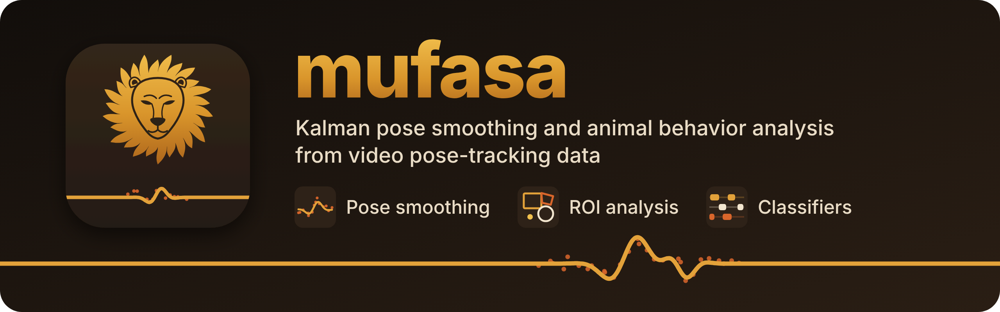

<p align="center">
  <picture>
    <source media="(max-width: 700px) and (prefers-color-scheme: light)" srcset="docs/images/mufasa_banner_mobile_light.png">
    <source media="(max-width: 700px)" srcset="docs/images/mufasa_banner_mobile_dark.png">
    <source media="(prefers-color-scheme: light)" srcset="docs/images/mufasa_banner_light.png">
    
  </picture>
</p>

[-blue.svg)](LICENSE)
[](https://www.python.org/)
[](https://www.qt.io/)
[](#)

Mufasa smooths pose-tracking data and analyses animal behavior from it: Kalman smoothing of tracked markers, regions of interest, feature extraction and supervised behavior classifiers, in one Qt workbench for Linux. It works with any animal a pose tracker can follow, from invertebrates to humans.

Mufasa began as a fork of [SimBA](https://github.com/sgoldenlab/simba) and keeps its classification pipeline, but has its own project layout and file formats and does not read SimBA projects.

* **Pose import** from FreeDLC, DeepLabCut (CSV / H5, single- and multi-animal), SLEAP (.slp / H5 / CSV), MARS, TRK, FaceMap, YOLO-pose and SuperAnimal-TopView.
* **Preprocessing**: video calibration, interpolation of missing frames, Kalman v2 smoothing, outlier correction and egocentric alignment.
* **Analysis**: ROIs, feature extraction, behavior labelling, classifier training, validation and inference, visualizations, and add-ons (cue lights, Kleinberg burst smoothing, pup retrieval, spontaneous alternation and more).
* **Projects** with separate read-only inputs (`sources/`) and regenerable outputs (`derived/`); each run of the pose stages (import, interpolation, smoothing, outlier correction) gets its own directory and a `run.toml` recording what produced it.

## The tools

<details>
<summary> <b>Pose smoothing</b>: Kalman smoothing of tracked markers</summary>

- Kalman v2 treats markers as observations of a kinematic tree (rigid segments joined by free joints, with slowly varying segment lengths), so a marker with low likelihood follows the body instead of wandering
- noise and segment parameters are fit to each video by EM; a fitted model can be saved and reused with `--load-model`
- runs inside a project (Preprocessing → Kalman v2 smoothing) or standalone on a pose file, writing beside the input
- `mufasa-preview` overlays the markers on the video

Docs: [workflows.md (Smooth pose)](docs/workflows.md) · [kalman_smoother_design.md](docs/kalman_smoother_design.md) · [v2_next_steps_design.md](docs/v2_next_steps_design.md)

</details>

<details>
<summary> <b>ROI analysis</b>: regions of interest and what the animal does in them</summary>

- editor for rectangles, circles and polygons with any number of vertices; drag vertices, edges and corners, undo/redo, zoom, copy ROIs to other videos
- every video's ROIs live in one file, `logs/measures/rois.json`
- time spent and entries per ROI, in aggregate or in time bins; directionality toward ROIs
- inside-ROI and distance-to-ROI features feed the classifiers

Docs: [workflows.md (Stage 4)](docs/workflows.md) · [roi_enhancements_proposal.md](docs/roi_enhancements_proposal.md)

</details>

<details>
<summary> <b>Classifiers</b>: supervised behavior classification</summary>

- feature extraction from the smoothed pose, computed per feature family in parallel worker processes
- behavior labelling, including pseudo-labelling and a targeted clip annotator
- random-forest training (single behavior, one per behavior, hyperparameter search)
- validation on a single video, batch inference, and per-bout analysis of the results

Docs: [workflows.md (Stages 5–8)](docs/workflows.md) · [workflow_recipes.md](docs/workflow_recipes.md)

</details>

## Running Mufasa

| Command | What it does |
|---|---|
| `mufasa` | Opens the Qt workbench after checking the environment (OpenCV, FFmpeg, …) and reporting anything missing. |
| `mufasa-workbench` | Opens the workbench directly, without the environment check. |
| `mufasa-preview` | Pose-overlay viewer: plays a video with its raw and smoothed markers, pairing files by session name (`--video`, or `--folder` to search a directory). |
| `mufasa-landscape` | Exploratory map of a project: loads the Kalman v2 pose and features of every session, finds column pairs with multimodal joint distributions (dip-test splitting) and plots their joint PDFs, and runs t-SNE on a frame sample. Needs the `analysis` extra. |

The workbench sidebar follows the pipeline:

| Page | What it covers |
|---|---|
| Projects | Create, open and inspect projects. |
| Data Import · Data inspector · Model modifications | Import pose data and videos, check column names, rename markers. |
| Preprocessing | Video preprocessing and calibration, interpolation, Kalman v2 smoothing, outlier correction, egocentric alignment. |
| ROI | Draw ROIs, analyse and visualise them, compute ROI features. |
| Features | Compute feature families from the smoothed pose. |
| Manage classifiers · Annotation · Train · Validate · Inference | Behavior labelling and the classifier workflow. |
| YOLO pose | Train and run YOLO pose models. |
| Analysis · Visualizations | Statistics over movement and classifications (aggregates, time bins, severity), plots and videos. |
| Video Processing · Add-ons · Tools | Video utilities, task-specific analyses, format conversion. |

The Kalman v2 smoother also runs without a project:

```bash
python -m mufasa.data_processors.kalman_pose_smoother_v2 session.parquet --beside-input
```

It takes CSV or parquet pose files (including FreeDLC runs), finds the project's skeleton when the file sits inside a project, and writes `<stem>_smoothed_v2.<hash>.parquet` next to the input. `--save-model` / `--load-model` save a fitted model and reuse it on other sessions.

Removed commands: `mufasa-tk` (Removed in patch 122d4, along with the Tk GUI), `mufasa-migrate-project` (122dw; only the v1 layout is supported) and `mufasa-chooser` (122dx; replaced by the workbench's Projects page).

## Project layout

Mufasa uses the v1 layout, configured by `project.toml`:

```
my_project/
├── project.toml                    ← project metadata, pose config, skeleton, settings
├── sources/                        ← inputs; never written by the pipeline
│   ├── videos/
│   ├── pose/                       ← tracker output as imported
│   ├── annotations/                ← optional
│   └── video_info.csv              ← calibration: fps, resolution, pixels/mm
├── derived/                        ← generated; safe to delete and regenerate
│   ├── pose/<run_id>/              ← import runs (links into sources/pose)
│   ├── interpolated/<run_id>/
│   ├── smoothed/kalman_v2/<run_id>/
│   ├── outlier_corrected/<run_id>/ ← what downstream stages read; smoothing and
│   │                                 interpolation runs are published here
│   ├── features/<family>/<video>.parquet
│   ├── labels/<video>.parquet
│   ├── classifications/<video>.parquet
│   └── plots/ · frames/ · …        ← visualisation and analysis outputs
├── models/                         ← Kalman models (model.npz + card.toml), classifiers
├── logs/
│   └── measures/rois.json          ← ROI definitions for every video
└── backups/                        ← snapshots taken before in-place edits (e.g. marker renames)
```

Run ids are `YYYYMMDD-HHMMSS-<6 hex>`, so the latest run sorts last; downstream stages read the latest run unless told otherwise. Derived data is stored as parquet. Fitted Kalman models are also mirrored to `~/.config/mufasa/models/` so they can be reused across projects.

See [`docs/v1_project_layout.md`](docs/v1_project_layout.md) for the full reference.

## Installation

```bash
git clone https://github.com/Gravios/mufasa.git
cd mufasa
python3 -m venv .venv            # Python 3.11 or later
source .venv/bin/activate
pip install -e ".[qt]"
```

The `qt` extra installs PySide6, which the workbench needs. Native Cython kernels are compiled during install, so a C compiler must be available. Other extras:

| Extra | Adds |
|---|---|
| `gpu` | CuPy for CUDA 12 (Numba's CUDA backend is used as well). |
| `onnx` | ONNX export and onnxruntime inference for classifiers. |
| `nvenc` | Marker only: hardware video encoding needs a system FFmpeg built with NVENC. |
| `analysis` | `diptest`, for `mufasa-landscape`. |
| `dev` | pytest, pytest-qt, ruff, mypy, pre-commit. |
| `all` | All of the above. |

Run `mufasa` to open the workbench.

## Documentation

Doc index: [`docs/README.md`](docs/README.md).

User-facing:

| Doc | When to read |
|---|---|
| [`docs/v1_project_layout.md`](docs/v1_project_layout.md) | Project layout, run ids, where each stage writes. |
| [`docs/workflow_recipes.md`](docs/workflow_recipes.md) | Eleven end-to-end recipes for common experimental setups. |
| [`docs/data_source_guides.md`](docs/data_source_guides.md) | Per-tracker import guide. |
| [`docs/testing_workflow.md`](docs/testing_workflow.md) | Walking a parquet-pose project through the pipeline. |

Design and developer-facing:

| Doc | When to read |
|---|---|
| [`docs/kalman_smoother_design.md`](docs/kalman_smoother_design.md) · [`docs/joint_model_design.md`](docs/joint_model_design.md) · [`docs/v2_next_steps_design.md`](docs/v2_next_steps_design.md) | How the Kalman smoother works and why. |
| [`docs/workflows.md`](docs/workflows.md) | Which workflow lives where, port status, known gaps. |
| [`docs/workflow_audit.md`](docs/workflow_audit.md) | Topological view of the system (pages, forms, backends, pipeline). |
| [`docs/qt_workbench_known_issues.md`](docs/qt_workbench_known_issues.md) | Known workbench issues. |
| [`CHANGELOG.md`](CHANGELOG.md) | What landed in each patch. |

## Relationship to SimBA

Mufasa started as a fork of SimBA and has since diverged:

* **GUI:** Qt (PySide6) workbench; the Tkinter GUI is gone.
* **Smoothing:** a joint-state Kalman smoother over a kinematic skeleton, fit per video, replaces moving-average smoothing.
* **Formats:** `project.toml` projects with `sources/` / `derived/` separation and per-run provenance, parquet throughout, ROIs in `rois.json`. SimBA projects (`project_config.ini`, `ROI_definitions.h5`) are not read.
* **Platform:** Linux and Python 3.11+ only; install from source.

The feature extraction and random-forest classification pipeline is SimBA's. If you want SimBA's cross-platform GUI, PyPI package and tutorials, use [SimBA](https://github.com/sgoldenlab/simba).

## Citation

If you use the feature-extraction or classifier pipeline in published work, cite the SimBA paper:

```bibtex
@article{Goodwin2024,
  author    = {Goodwin, Nastacia L. and Choong, Jia J. and Hwang, Sophia and
               Pitts, Kayla and Bloom, Liana and Islam, Aasiya and
               Zhang, Yizhe Y. and Szelenyi, Eric R. and Tong, Xiaoyu and
               Newman, Emily L. and Miczek, Klaus and Wright, Hayden R. and
               McLaughlin, Ryan J. and Norville, Zane C. and Eshel, Neir and
               Heshmati, Mitra and Nilsson, Simon R. O. and Golden, Sam A.},
  title     = {Simple Behavioral Analysis (SimBA) as a platform for
               explainable machine learning in behavioral neuroscience},
  journal   = {Nature Neuroscience},
  volume    = {27},
  pages     = {1411--1424},
  year      = {2024},
  doi       = {10.1038/s41593-024-01649-9},
  publisher = {Nature Publishing Group},
  url       = {https://www.nature.com/articles/s41593-024-01649-9},
}
```

## License

BSD 3-Clause License, modified for academic and research use only, inherited from SimBA. See [`LICENSE`](LICENSE); for commercial licensing contact the copyright holder named there.

## Acknowledgments

Mufasa builds on the work of the SimBA project at the [Golden Lab, University of Washington](https://goldenneurolab.com/). Mufasa-specific changes are recorded patch by patch in [`CHANGELOG.md`](CHANGELOG.md).

Original SimBA contributors:

* [Simon Nilsson](https://github.com/sronilsson)
* [Jia Jie Choong](https://github.com/inoejj)
* [Sophia Hwang](https://github.com/sophihwang26)

See [github.com/sgoldenlab/simba](https://github.com/sgoldenlab/simba) for the upstream project, the full contributor list, and the original SimBA documentation, tutorials and scientific references.
