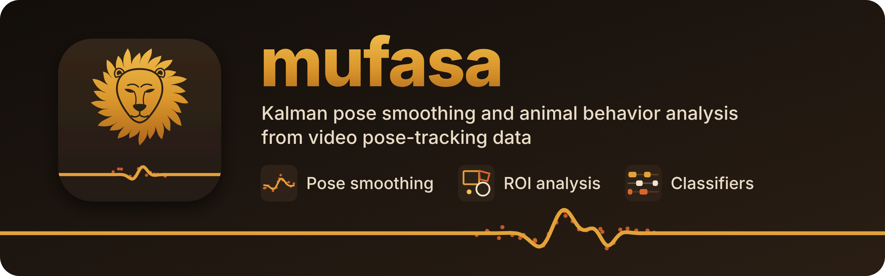

<p align="center">
  <picture>
    <source media="(max-width: 700px) and (prefers-color-scheme: light)" srcset="docs/images/mufasa_banner_mobile_light.png">
    <source media="(max-width: 700px)" srcset="docs/images/mufasa_banner_mobile_dark.png">
    <source media="(prefers-color-scheme: light)" srcset="docs/images/mufasa_banner_light.png">
    
  </picture>
</p>

[-blue.svg)](LICENSE)
[](https://www.python.org/)
[](https://www.qt.io/)
[](#)

Mufasa smooths pose-tracking data and analyses animal behavior from it: Kalman smoothing of tracked markers, regions of interest, feature extraction and supervised behavior classifiers, in one Qt workbench for Linux. It works with any animal a pose tracker can follow, from invertebrates to humans.

Mufasa began as a fork of [SimBA](https://github.com/sgoldenlab/simba) and keeps its classification pipeline, but has its own project layout and file formats and does not read SimBA projects.

* **Pose import** from FreeDLC, DeepLabCut (CSV / H5, single- and multi-animal), SLEAP (.slp / H5 / CSV), MARS, TRK, FaceMap, YOLO-pose and SuperAnimal-TopView.
* **Preprocessing**: video calibration, interpolation of missing frames, Kalman v2 smoothing, outlier correction and egocentric alignment.
* **Analysis**: ROIs, feature extraction, behavior labelling, classifier training, validation and inference, visualizations, and add-ons (cue lights, Kleinberg burst smoothing, pup retrieval, spontaneous alternation and more).
* **Projects** with separate read-only inputs (`sources/`) and regenerable outputs (`derived/`); each run of the pose stages (import, interpolation, smoothing, outlier correction) gets its own directory and a `run.toml` recording what produced it.

## The tools

<details>
<summary> <b>Pose smoothing</b>: Kalman smoothing of tracked markers</summary>

- Kalman v2 treats markers as observations of a kinematic tree (rigid segments joined by free joints, with slowly varying segment lengths), so a marker with low likelihood follows the body instead of wandering
- noise and segment parameters are fit to each video by EM; a fitted model can be saved and reused with `--load-model`
- runs inside a project (Preprocessing → Kalman v2 smoothing) or standalone on a pose file, writing beside the input
- `mufasa-preview` overlays the markers on the video

Docs: [workflows.md (Smooth pose)](docs/workflows.md) · [kalman_smoother_design.md](docs/kalman_smoother_design.md) · [v2_next_steps_design.md](docs/v2_next_steps_design.md)

</details>

<details>
<summary> <b>ROI analysis</b>: regions of interest and what the animal does in them</summary>

- editor for rectangles, circles and polygons with any number of vertices; drag vertices, edges and corners, undo/redo, zoom, copy ROIs to other videos
- every video's ROIs live in one file, `logs/measures/rois.json`
- time spent and entries per ROI, in aggregate or in time bins; directionality toward ROIs
- inside-ROI and distance-to-ROI features feed the classifiers

Docs: [workflows.md (Stage 4)](docs/workflows.md) · [roi_enhancements_proposal.md](docs/roi_enhancements_proposal.md)

</details>

<details>
<summary> <b>Classifiers</b>: supervised behavior classification</summary>

- feature extraction from the smoothed pose, computed per feature family in parallel worker processes
- behavior labelling, including pseudo-labelling and a targeted clip annotator
- random-forest training (single behavior, one per behavior, hyperparameter search)
- validation on a single video, batch inference, and per-bout analysis of the results

Docs: [workflows.md (Stages 5–8)](docs/workflows.md) · [workflow_recipes.md](docs/workflow_recipes.md)

</details>

## Running Mufasa

| Command | What it does |
|---|---|
| `mufasa` | Opens the Qt workbench after checking the environment (OpenCV, FFmpeg, …) and reporting anything missing. |
| `mufasa help` | The commands below and mufasa's other tools; `mufasa help <command>` for a command's options. `mufasa list models` lists every model a project can use (Kalman body models, classifiers, detectors, 3-D bodies, priors); `mufasa list` also takes `videos`, `pose`, `3d`, `runs`, `calibrations`, `steps`, `tools`, `projects`. `mufasa info FILE` says what a file holds, `mufasa project` summarises a project, `mufasa doctor` checks the environment (see [`docs/cli.md`](docs/cli.md)). |
| `mufasa run <step>` | The 3-D pipeline from the command line, one step at a time: `calibrate box\|checkerboard`, `3d-inference`, `smooth`, `heights`, `gait-extrapolation`, `body-fit`, `dynamics` (the `mufasa-pose3d` commands under pipeline names). `mufasa run all --pose X.parquet --camera cam.toml` chains 3d-inference → heights → gait-extrapolation → dynamics, skips steps that are up to date, and records each run in `X_run.json`. `mufasa run --list` lists the steps. |
| `mufasa-workbench` | Opens the workbench directly, without the environment check. |
| `mufasa-preview` | Pose-overlay viewer: plays a video with its raw and smoothed markers, pairing files by session name (`--video`, or `--folder` to search a directory). |
| `mufasa-landscape` | Exploratory map of a project: loads the Kalman v2 pose and features of every session, finds column pairs with multimodal joint distributions (dip-test splitting) and plots their joint PDFs, and runs t-SNE on a frame sample. Needs the `analysis` extra. |
| `mufasa-landscape-animate` | Animated GIF (and MP4) of a `mufasa-landscape` run for presentations: the sampled frames glide from the t-SNE map into the joint scatter of each chosen feature pair and back, coloured by their position in the t-SNE map. |
| `mufasa-pose3d` | 3-D pose from the command line: camera calibration from marked box edges or a checkerboard, single-camera or stereo 3-D inference, 3-D Kalman smoothing (see [`docs/pose3d.md`](docs/pose3d.md)); `body-rig` / `body-fit` fit a rigged body model to video (see [`docs/bodymodel.md`](docs/bodymodel.md)); `dynamics` gives joint torques and ground forces (see [`docs/biomech.md`](docs/biomech.md)). |
| `mufasa-view3d` | 3-D marker viewer with the video below the reconstruction volume. |
| `mufasa-relink` | Makes a project's file links (imported videos) relative, so they survive mounting the project elsewhere (sshfs, NFS); finds the targets through the mount offset when run on the mount. The workbench does this when it opens a project. |

The workbench sidebar follows the pipeline:

| Page | What it covers |
|---|---|
| Projects | Create, open and inspect projects. |
| Data Import · Data inspector · Model modifications | Import pose data and videos, re-import the skeleton model (markers and skeleton) from a retrained model's pose file, check column names, rename markers. |
| Preprocessing | Video preprocessing and calibration, interpolation, Kalman v2 smoothing, outlier correction, egocentric alignment. |
| 3-D | Camera calibration, 3-D pose from one or two cameras, 3-D Kalman smoothing, the 3-D viewer. |
| Body model | Fit a rigged 3-D model (from Blender) to top-down video, within joint limits, forwards and backwards over time; overlay video (see [`docs/bodymodel.md`](docs/bodymodel.md)). |
| ROI | Draw ROIs, analyse and visualise them, compute ROI features. |
| Features | Compute feature families from the smoothed pose. |
| Manage classifiers · Annotation · Train · Validate · Inference | Behavior labelling and the classifier workflow. |
| YOLO pose | Train and run YOLO pose models. |
| Analysis · Visualizations | Statistics over movement and classifications (aggregates, time bins, severity), plots and videos. |
| Video Processing · Add-ons · Tools | Video utilities, task-specific analyses, format conversion. |

The Kalman v2 smoother also runs without a project:

```bash
python -m mufasa.data_processors.kalman_pose_smoother_v2 session.parquet --beside-input
```

It takes CSV or parquet pose files (including FreeDLC runs), finds the project's skeleton when the file sits inside a project, and writes `<stem>_smoothed_v2.<hash>.parquet` next to the input. `--save-model` / `--load-model` save a fitted model and reuse it on other sessions.

Removed commands: `mufasa-tk` (Removed in patch 122d4, along with the Tk GUI), `mufasa-migrate-project` (122dw; only the v1 layout is supported) and `mufasa-chooser` (122dx; replaced by the workbench's Projects page).

## Project layout

Mufasa uses the v1 layout, configured by `project.toml`:

```
my_project/
├── project.toml                    ← project metadata, pose config, skeleton, settings
├── sources/                        ← inputs; never written by the pipeline
│   ├── videos/
│   ├── pose/                       ← tracker output as imported
│   ├── annotations/                ← optional
│   └── video_info.csv              ← calibration: fps, resolution, pixels/mm
├── derived/                        ← generated; safe to delete and regenerate
│   ├── pose/<run_id>/              ← import runs (links into sources/pose)
│   ├── interpolated/<run_id>/
│   ├── smoothed/kalman_v2/<run_id>/
│   ├── outlier_corrected/<run_id>/ ← what downstream stages read; smoothing and
│   │                                 interpolation runs are published here
│   ├── features/<family>/<video>.parquet
│   ├── labels/<video>.parquet
│   ├── classifications/<video>.parquet
│   └── plots/ · frames/ · …        ← visualisation and analysis outputs
├── models/                         ← Kalman models (model.npz + card.toml), classifiers
├── logs/
│   └── measures/rois.json          ← ROI definitions for every video
└── backups/                        ← snapshots taken before in-place edits (e.g. marker renames)
```

Run ids are `YYYYMMDD-HHMMSS-<6 hex>`, so the latest run sorts last; downstream stages read the latest run unless told otherwise. Derived data is stored as parquet. Fitted Kalman models are also mirrored to `~/.config/mufasa/models/` so they can be reused across projects.

See [`docs/v1_project_layout.md`](docs/v1_project_layout.md) for the full reference.

## Installation

```bash
git clone https://github.com/Gravios/mufasa.git
cd mufasa
python3 -m venv .venv            # Python 3.11 or later
source .venv/bin/activate
pip install -e ".[qt]"            # add pose3d for 3-D pose: ".[qt,pose3d]"
```

The `qt` extra installs PySide6, which the workbench needs. Native Cython kernels are compiled during install, so a C compiler must be available. Other extras:

| Extra | Adds |
|---|---|
| `biomech` | MuJoCo (3.2+), for the biomechanical model: joint torques, ground forces and hindlimb muscle forces from 3-D poses (`mufasa-pose3d dynamics`). |
| `pose3d` | PyTorch (2.7+), for 3-D inference's faster solvers (CPU and GPU) and the 3-D viewer's posing. On Linux, PyTorch 2.11+ from PyPI is a CUDA 13 build; with an older NVIDIA driver, install `torch` from `https://download.pytorch.org/whl/cu128` first. `mufasa-pose3d gpu-check` says what is missing. |
| `gpu` | CuPy for CUDA 12 and PyTorch (Numba's CUDA backend is used as well). |
| `onnx` | ONNX export and onnxruntime inference for classifiers. |
| `nvenc` | Marker only: hardware video encoding needs a system FFmpeg built with NVENC. |
| `analysis` | `diptest`, for `mufasa-landscape`. |
| `dev` | pytest, pytest-qt, ruff, mypy, pre-commit. |
| `all` | All of the above. |

Run `mufasa` to open the workbench.

## Documentation

Doc index: [`docs/README.md`](docs/README.md).

User-facing:

| Doc | When to read |
|---|---|
| [`docs/v1_project_layout.md`](docs/v1_project_layout.md) | Project layout, run ids, where each stage writes. |
| [`docs/workflow_recipes.md`](docs/workflow_recipes.md) | Eleven end-to-end recipes for common experimental setups. |
| [`docs/data_source_guides.md`](docs/data_source_guides.md) | Per-tracker import guide. |
| [`docs/testing_workflow.md`](docs/testing_workflow.md) | Walking a parquet-pose project through the pipeline. |

Design and developer-facing:

| Doc | When to read |
|---|---|
| [`docs/kalman_smoother_design.md`](docs/kalman_smoother_design.md) · [`docs/joint_model_design.md`](docs/joint_model_design.md) · [`docs/v2_next_steps_design.md`](docs/v2_next_steps_design.md) | How the Kalman smoother works and why. |
| [`docs/workflows.md`](docs/workflows.md) | Which workflow lives where, port status, known gaps. |
| [`docs/workflow_audit.md`](docs/workflow_audit.md) | Topological view of the system (pages, forms, backends, pipeline). |
| [`docs/qt_workbench_known_issues.md`](docs/qt_workbench_known_issues.md) | Known workbench issues. |
| [`CHANGELOG.md`](CHANGELOG.md) | What landed in each patch. |

## Relationship to SimBA

Mufasa started as a fork of SimBA and has since diverged:

* **GUI:** Qt (PySide6) workbench; the Tkinter GUI is gone.
* **Smoothing:** a joint-state Kalman smoother over a kinematic skeleton, fit per video, replaces moving-average smoothing.
* **Formats:** `project.toml` projects with `sources/` / `derived/` separation and per-run provenance, parquet throughout, ROIs in `rois.json`. SimBA projects (`project_config.ini`, `ROI_definitions.h5`) are not read.
* **Platform:** Linux and Python 3.11+ only; install from source.

The feature extraction and random-forest classification pipeline is SimBA's. If you want SimBA's cross-platform GUI, PyPI package and tutorials, use [SimBA](https://github.com/sgoldenlab/simba).

## Citation

If you use the feature-extraction or classifier pipeline in published work, cite the SimBA paper:

```bibtex
@article{Goodwin2024,
  author    = {Goodwin, Nastacia L. and Choong, Jia J. and Hwang, Sophia and
               Pitts, Kayla and Bloom, Liana and Islam, Aasiya and
               Zhang, Yizhe Y. and Szelenyi, Eric R. and Tong, Xiaoyu and
               Newman, Emily L. and Miczek, Klaus and Wright, Hayden R. and
               McLaughlin, Ryan J. and Norville, Zane C. and Eshel, Neir and
               Heshmati, Mitra and Nilsson, Simon R. O. and Golden, Sam A.},
  title     = {Simple Behavioral Analysis (SimBA) as a platform for
               explainable machine learning in behavioral neuroscience},
  journal   = {Nature Neuroscience},
  volume    = {27},
  pages     = {1411--1424},
  year      = {2024},
  doi       = {10.1038/s41593-024-01649-9},
  publisher = {Nature Publishing Group},
  url       = {https://www.nature.com/articles/s41593-024-01649-9},
}
```

## Scientific references

The methods, data and models Mufasa's code draws on, by area. Each module's docstring says
which one it uses. Entries marked *(reference to be confirmed)* are cited in the code by author
and year only; their full reference has not been checked.

### 3-D pose, body model and gait

* Merel, J., Aldarondo, D., Marshall, J., Tassa, Y., Wayne, G. & Ölveczky, B. (2020). Deep
  neuroethology of a virtual rodent. *ICLR 2020*. The virtual rodent's skeleton, joint ranges,
  masses and skin (dm_control, Apache 2.0): anatomical limits in 3-D inference, the viewer's
  rig, body physics for gait. `mufasa/pose3d/rodent_model.py`, `mufasa/bodymodel/rodent_rig.py`
* Dunn, T. W., Marshall, J. D., Severson, K. S., Aldarondo, D. E., Hildebrand, D. G. C.,
  Chettih, S. N., Wang, W. L., Gellis, A. J., Carlson, D. E., Aronov, D., Freiwald, W. A.,
  Wang, F. & Ölveczky, B. P. (2021). Geometric deep learning enables 3D kinematic profiling
  across species and environments. *Nature Methods* 18, 564–573. Rat7M motion capture (CC BY
  4.0): the trunk prior for single-camera 3-D. `scripts/build_rat7m_prior.py`
* Neckel, N. D. et al. (2013). *Journal of Neuroscience Methods* 216, 62; data: Mendeley Data
  sg3d7dv345. CatWalk strides of uninjured adult rats: the gait's speed laws
  *(reference to be confirmed)*. `scripts/calibrate_gait_catwalk.py`, `mufasa/pose3d/gait.py`
* Lu et al. (2026). TactileArena demo recording: a check on the gait bounds
  *(reference to be confirmed)*. `mufasa/pose3d/gait.py`
* Mendes, C. S., Bartos, I., Márka, Z., Akay, T., Márka, S. & Mann, R. S. (2015).
  Quantification of gait parameters in freely walking rodents. *BMC Biology* 13, 50.
  https://doi.org/10.1186/s12915-015-0154-0. Mouse gait bounds. `mufasa/pose3d/gait.py`
* Hof, A. L., Gazendam, M. G. J. & Sinke, W. E. (2005). The condition for dynamic stability.
  *Journal of Biomechanics* 38, 1–8. The extrapolated centre of mass. `mufasa/pose3d/gait.py`
* Dewan et al. (2010) and Shahrokni et al. (2012): spinal ranges of motion, via the HBP mouse
  model's joint table *(references to be confirmed)*. `mufasa/bodymodel/fit.py`

**For the biomechanical model** (`mufasa/biomech`, docs/biomech.md):

* Todorov, E., Erez, T. & Tassa, Y. (2012). MuJoCo: A physics engine for model-based control.
  *IEEE/RSJ IROS 2012*, 5026–5033. Inverse dynamics.
* Wu, T., Tassa, Y., Kumar, V., Movellan, J. & Todorov, E. (2013). STAC: Simultaneous tracking
  and calibration. *IEEE-RAS Humanoids 2013*. Label calibration. `mufasa/biomech/fit.py`
* Aldarondo, D., Merel, J., Marshall, J. D. et al. (2024). A virtual rodent predicts the
  structure of neural activity across behaviours. *Nature* 632, 594–602. STAC on the virtual
  rodent.
* Savitzky, A. & Golay, M. J. E. (1964). Smoothing and differentiation of data by simplified
  least squares procedures. *Analytical Chemistry* 36, 1627–1639. Joint velocities and
  accelerations.
* Eng, C. M., Smallwood, L. H., Rainiero, M. P., Lahey, M., Ward, S. R. & Lieber, R. L. (2008).
  Scaling of muscle architecture and fiber types in the rat hindlimb. *Journal of Experimental
  Biology* 211, 2336–2345. Hindlimb muscle architecture (Table 1): the `eng2008` option.
  `mufasa/biomech/osim.py`
* Johnson, W. L., Jindrich, D. L., Roy, R. R. & Edgerton, V. R. (2008). A three-dimensional
  model of the rat hindlimb: musculoskeletal geometry and muscle moment arms. *Journal of
  Biomechanics* 41, 610–619. The OpenSim rat hindlimb model the muscles are read from (not
  shipped; SimTK `rat_hlimb_model`). `mufasa/biomech/osim.py`
* Johnson, W. L., Jindrich, D. L., Zhong, H., Roy, R. R. & Edgerton, V. R. (2011). Application
  of a rat hindlimb model: a prediction of force spaces reachable through stimulation of nerve
  fascicles. *IEEE Transactions on Biomedical Engineering* 58, 3328–3338. Muscle parameters.
* Young, F., Rode, C., Hunt, A. & Quinn, R. (2019). Analyzing moment arm profiles in a
  full-muscle rat hindlimb model. *Biomimetics* 4, 10. Muscle attachments of the bilateral
  model (UVA MAMP Lab, github.com/UVA-MAMP-Lab/RatHindlimb).
* Zajac, F. E. (1989). Muscle and tendon: properties, models, scaling, and application to
  biomechanics and motor control. *Critical Reviews in Biomedical Engineering* 17, 359–411.
  The Hill-type muscle with a rigid tendon. `mufasa/biomech/muscle.py`
* Thelen, D. G. (2003). Adjustment of muscle mechanics model parameters to simulate dynamic
  contractions in older adults. *Journal of Biomechanical Engineering* 125, 70–77. Force–length
  curves.
* Crowninshield, R. D. & Brand, R. A. (1981). A physiologically based criterion of muscle force
  prediction in locomotion. *Journal of Biomechanics* 14, 793–801. Static optimisation.
* Anderson, F. C. & Pandy, M. G. (2001). Static and dynamic optimization solutions for gait are
  practically equivalent. *Journal of Biomechanics* 34, 153–161. Static optimisation for gait.
* Powell, P. L., Roy, R. R., Kanim, P., Bello, M. A. & Edgerton, V. R. (1984). Predictability of
  skeletal muscle tension from architectural determinations in guinea pig hindlimbs. *Journal of
  Applied Physiology* 57, 1715–1721. Specific tension, 22.5 N/cm².
* Li, W. & Todorov, E. (2004). Iterative linear quadratic regulator design for nonlinear
  biological movement systems. *ICINCO 2004*, 222–229. Forward and backward sweeps (iLQR); the
  whole-window solve does their work at once. `mufasa/biomech/optimise.py`
* Ackermann, M. & van den Bogert, A. J. (2010). Optimality principles for model-based
  prediction of human gait. *Journal of Biomechanics* 43, 1055–1060. Tracking and effort
  optimised together over a movement.
* Mak, J. N. E. (2021). *Building a Biomechanical Model of a Rat Forelimb.* MSc thesis,
  Portland State University. https://doi.org/10.15760/etd.7690. Forelimb chain and Hill-type
  muscle parameters, predicted from dog data.
* Valdez, S. I., González-Sandoval, J., Dueñas-Jiménez, S., Franco Rodríguez, N. E.,
  Torres-Ramos, S. & Mendizabal-Ruiz, G. (2018). Modeling hind-limb kinematics using a
  bio-inspired algorithm with a local search. *BioMedical Engineering OnLine* 17(Suppl 1), 134.
  https://doi.org/10.1186/s12938-018-0565-6. The leg pendulum-like movement angle.
* *A Laboratory Manual of the Anatomy of the Rat*, "The Muscular System" (Wikisource):
  muscle origins and insertions.

### Pose estimation, tracking and smoothing

* Lauer, J. et al. (2022). Multi-animal pose estimation, identification and tracking with
  DeepLabCut. *Nature Methods*. `mufasa/pose_importers/madlc_importer.py`
* Pereira, T. D. et al. (2022). SLEAP: A deep learning system for multi-animal pose tracking.
  *Nature Methods*. `mufasa/pose_importers/sleap_*`
* Biderman, D. et al. (2024). Lightning Pose: improved animal pose estimation via
  semi-supervised learning, Bayesian ensembling and cloud-native open-source tools. *Nature
  Methods*. https://doi.org/10.1038/s41592-024-02319-1. Its ensemble Kalman smoother informs
  Mufasa's (`docs/kalman_smoother_design.md`).
* Ye, S., Filippova, A., Lauer, J. et al. (2024). SuperAnimal pretrained pose estimation models
  for behavioral analysis. *Nature Communications* 15, 5165.
  https://doi.org/10.1038/s41467-024-48792-2
* Segalin, C. et al. (2021). The Mouse Action Recognition System (MARS) software pipeline for
  automated analysis of social behaviors in mice. *eLife*. https://doi.org/10.7554/eLife.63720
* Karashchuk, P. et al. (2021). Anipose: a toolkit for robust markerless 3D pose estimation.
  *Cell Reports*.
* Günel, S. et al. (2019). DeepFly3D. *eLife*. Yang et al. (2016) and Amin et al. (2013):
  pictorial structures *(references to be confirmed)*. All three are cited as related work in
  `docs/kalman_smoother_design.md`.
* Vandenhof et al. (2025). Consistent multi-animal pose estimation in cattle using dynamic
  Kalman filter based tracking. arXiv:2503.10450.
* Hertzberg, C., Wagner, R., Frese, U. & Schröder, L. (2013). Integrating generic sensor fusion
  algorithms with sound state representations through encapsulation of manifolds. *Information
  Fusion* 14, 57–77. Angles on the unit circle in the Kalman smoother.
* Weinreb, C. et al. (2024). Keypoint-MoSeq: parsing behavior by linking point tracking to pose
  dynamics. *Nature Methods* 21, 1329–1339.
* Pennington, Z. T. et al. (2019). ezTrack: An open-source video analysis pipeline for the
  investigation of animal behavior. *Scientific Reports* 9, 19979.
  https://doi.org/10.1038/s41598-019-56408-9
* Silverman, B. W. (1986). *Density Estimation for Statistics and Data Analysis.* Friedman,
  J. H., Bentley, J. L. & Finkel, R. A. (1977). An algorithm for finding best matches in
  logarithmic expected time. *ACM Transactions on Mathematical Software* 3, 209–226.

### Behaviour measures and detectors

* Sabnis, G., Hession, L., Mahoney, J. M., Mobley, A., Santos, M. & Kumar, V. (2024). Visual
  detection of seizures in mice using supervised machine learning. *bioRxiv*.
  https://doi.org/10.1101/2024.05.29.596520; *Cell Reports Methods* 5, 101242 (2025).
* Lazaro et al. (2025). Brainwide genetic capture for conscious state transitions. *bioRxiv*.
  https://doi.org/10.1101/2025.03.28.646066
* Lopez, G. C., Van Camp, L. D., Kovaleski, R. F. et al. (2025). Region-specific nucleus
  accumbens dopamine signals encode distinct aspects of avoidance learning. *Current Biology*
  35, 2433–2443.e5. https://doi.org/10.1016/j.cub.2025.04.006 (preprint:
  https://doi.org/10.1101/2024.08.28.610149)
* Hession, L. E., Sabnis, G. S., Churchill, G. A. & Kumar, V. (2022). A machine-vision-based
  frailty index for mice. *Nature Aging* 2, 756–766. https://doi.org/10.1038/s43587-022-00266-0
* Winters, C., Gorssen, W., Ossorio-Salazar, V. A., Nilsson, S., Golden, S. & D'Hooge, R.
  (2022). Automated procedure to assess pup retrieval in laboratory mice. *Scientific Reports*
  12, 1663. https://doi.org/10.1038/s41598-022-05641-w
* Lapp, H. E., Salazar, M. G. & Champagne, F. A. (2023). Automated maternal behavior during
  early life in rodents (AMBER) pipeline. *Scientific Reports* 13, 18277.
  https://doi.org/10.1038/s41598-023-45495-4
* Mitelut, C. et al. (2023). A behavioral roadmap for the development of agency in the rodent.
  *bioRxiv*. https://doi.org/10.1101/2023.11.10.566632; Mitelut, C. et al. (2025). Continuous
  monitoring and machine vision reveals that developing gerbils exhibit structured social
  behaviors prior to the emergence of autonomy. *PLOS Biology* 23, e3003348.
  https://doi.org/10.1371/journal.pbio.3003348
* Padmanaban, N. et al. (2025). Automated behavioral profiling using neural networks reveals
  differences in stress-like behavior between cave and surface-dwelling *Astyanax mexicanus*.
  *bioRxiv*. https://doi.org/10.1101/2025.01.30.635725
* Popik, P. et al. (2024). Deep learning algorithms reveal increased social activity in rats at
  the onset of the dark phase of the light/dark cycle. *PLOS ONE* 19, e0307794.
  https://doi.org/10.1371/journal.pone.0307794; Popik, P. et al. (2024). Effects of ketamine
  on rat social behavior as analyzed by DeepLabCut and SimBA deep learning algorithms.
  *Frontiers in Pharmacology* 14, 1329424. https://doi.org/10.3389/fphar.2023.1329424
* Chanthongdee et al. (2024). Comprehensive ethological analysis of fear expression in rats
  using DeepLabCut and SimBA machine learning model. *Frontiers in Behavioral Neuroscience*.
  https://doi.org/10.3389/fnbeh.2024.1440601
* López-Moraga, A., Luyten, L. & Beckers, T. (2025). Generalization and extinction of
  platform-mediated avoidance in male and female rats. *Scientific Reports* 15, 9730.
  https://doi.org/10.1038/s41598-025-94265-x
* Boorman, D. C., Rehal, S. K., Fazili, M. & Martin, L. J. (2025). Sex and strain differences
  in analgesic and hyperlocomotor effects of morphine and μ-opioid receptor expression in mice.
  *Journal of Neuroscience Research* 103, e70039. https://doi.org/10.1002/jnr.70039
* Battivelli, D. et al. (2024). Induction of territorial dominance and subordination behaviors
  in laboratory mice. *Scientific Reports* 14, 28655. https://doi.org/10.1038/s41598-024-75545-4
* Lee et al. (2019). Temporal microstructure of dyadic social behavior during relationship
  formation in mice. *PLOS ONE*. Bordes et al. (2022). Automatically annotated motion tracking
  identifies a distinct social behavioral profile following chronic social defeat stress.
  *bioRxiv*.
* Kleinberg, J. (2003). Bursty and hierarchical structure in streams. *Data Mining and
  Knowledge Discovery* 7, 373–397.
* Cutts, C. S. & Eglen, S. J. (2014). Detecting pairwise correlations in spike trains: an
  objective comparison of methods and application to the study of retinal waves. *Journal of
  Neuroscience*.
* Shonka, S. & Hylin, M. J. Younger is better but only for males: social behavioral development
  following juvenile traumatic brain injury to the prefrontal cortex (n.d.).
* Casarrubea, M. et al. (2022). Structural analyses in the study of behavior: from rodents to
  non-human primates. *Frontiers in Psychology* 13. https://doi.org/10.3389/fpsyg.2022.1033561
* Lloyd, B. P., Yoder, P. J., Tapp, J. & Staubitz, J. L. (2016). The relative accuracy and
  interpretability of five sequential analysis methods: a simulation study. *Behavior Research
  Methods* 48, 1482–1491. https://doi.org/10.3758/s13428-015-0661-5
* Lawrence, C. E. et al. (1993). Detecting subtle sequence signals: a Gibbs sampling strategy for
  multiple alignment. *Science* 262, 208–214.

### Statistics and machine learning

* Frank, E. & Hall, M. (2001). A simple approach to ordinal classification. *ECML 2001*, LNCS
  2167, 145–156. https://doi.org/10.1007/3-540-44795-4_13; Wurm, M. J., Rathouz, P. J. &
  Hanlon, B. M. (2021). Regularized ordinal regression and the ordinalNet R package. *Journal of
  Statistical Software* 99(6).
* Liu, F. T., Ting, K. M. & Zhou, Z.-H. (2008). Isolation forest. *IEEE ICDM 2008*, 413–422.
  https://doi.org/10.1109/ICDM.2008.17
* Youden, W. J. (1950). Index for rating diagnostic tests. *Cancer* 3, 32–35.
* Mardia, K. V. (1976). Linear-circular correlation coefficients and rhythmometry. *Biometrika*
  63, 403–405.
* Kanatani, K. & Rangarajan, P. (2011). Hyper least squares fitting of circles and ellipses.
  *Computational Statistics & Data Analysis* 55, 2197–2208.
* Gower, J. C. (1971). A general coefficient of similarity and some of its properties.
  *Biometrics* 27, 857–874. https://doi.org/10.2307/2528823
* Cilibrasi, R. & Vitányi, P. (2005). Clustering by compression. *IEEE Transactions on
  Information Theory* 51, 1523–1545. https://doi.org/10.1109/TIT.2005.862080
* Hedges, T. S. (1976). An empirical modification to linear wave theory. *Proceedings of the
  Institution of Civil Engineers* 61, 575–579. https://doi.org/10.1680/iicep.1976.3408
* Cluster validity indices: Xie & Beni (1991), *IEEE TPAMI* 13, 841–847,
  https://doi.org/10.1109/34.85677; Bouguessa, Wang & Sun (2006), *Pattern Recognition
  Letters* 27, 1419–1430, https://doi.org/10.1016/j.patrec.2006.01.015; Zhao, Xu & Fränti
  (2009), *ICANNGA 2009*, LNCS 5495, https://doi.org/10.1007/978-3-642-04921-7_32; Halkidi,
  Vazirgiannis & Batistakis (2000), *PKDD 2000*, LNCS 1910,
  https://doi.org/10.1007/3-540-45372-5_26; Halkidi & Vazirgiannis (2001), *IEEE ICDM*,
  187–194; Hubert & Levin (1976), *Psychological Bulletin* 83, 1072–1080; Milligan & Cooper
  (1985), *Psychometrika* 50, 159–179, https://doi.org/10.1007/BF02294245; Krzanowski & Lai
  (1988), *Biometrics* 44, 23–34, https://doi.org/10.2307/2531893; Gurrutxaga et al. (2011),
  *Pattern Recognition* 44, 810–820, https://doi.org/10.1016/j.patcog.2010.10.002; Pakhira,
  Bandyopadhyay & Maulik (2004), *Pattern Recognition* 37, 487–501,
  https://doi.org/10.1016/j.patcog.2003.09.021; Banfield & Raftery (1993), *Biometrics* 49,
  803–821, https://doi.org/10.2307/2532201; Scott & Symons (1971), *Biometrics* 27, 387–397;
  McClain & Rao (1975), *Journal of Marketing Research* 12, 456–460,
  https://doi.org/10.1177/002224377501200410; Ray & Turi (1999), *ICAPRDT*, 137–143.
  Reviews: Ikotun, Habyarimana & Ezugwu (2025), *Heliyon* 11, e41953,
  https://doi.org/10.1016/j.heliyon.2025.e41953; Hassan et al. (2024),
  arXiv:2407.20246; Desgraupes, *clusterCrit* vignette (CRAN).

## License

BSD 3-Clause License, modified for academic and research use only, inherited from SimBA. See [`LICENSE`](LICENSE); for commercial licensing contact the copyright holder named there.

## Acknowledgments

Mufasa builds on the work of the SimBA project at the [Golden Lab, University of Washington](https://goldenneurolab.com/). Mufasa-specific changes are recorded patch by patch in [`CHANGELOG.md`](CHANGELOG.md).

Original SimBA contributors:

* [Simon Nilsson](https://github.com/sronilsson)
* [Jia Jie Choong](https://github.com/inoejj)
* [Sophia Hwang](https://github.com/sophihwang26)

See [github.com/sgoldenlab/simba](https://github.com/sgoldenlab/simba) for the upstream project, the full contributor list, and the original SimBA documentation, tutorials and scientific references.
